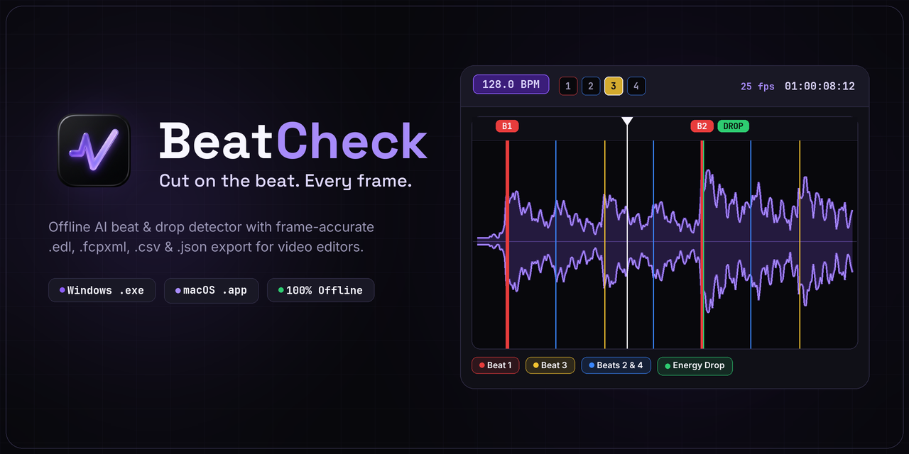
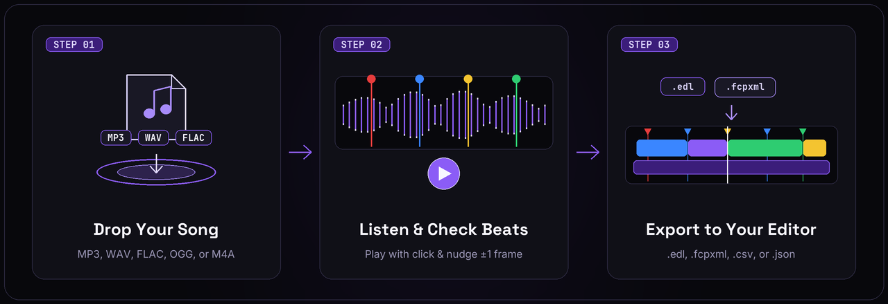

<p align="center">
  
</p>

<p align="center">
  <strong>Automatically mark every beat, downbeat, clap, and bass drop in your music — then drop those color-coded markers straight into your video editor.</strong>
</p>

<p align="center">
  <a href="https://github.com/migboss/BeatCheck/releases/latest"><strong>⬇ Download for Windows (.exe) &amp; macOS (.app)</strong></a>
  &nbsp;·&nbsp;
  <a href="#how-it-works">How It Works</a>
  &nbsp;·&nbsp;
  <a href="#supported-video-editors">Supported Editors</a>
  &nbsp;·&nbsp;
  <a href="#keyboard-shortcuts">Shortcuts</a>
</p>

---

## Download BeatCheck (Free · No Install Needed)

BeatCheck is a **single, portable app** that runs 100% offline on your computer — no account, no subscription, no Python setup, and no installer required.

### 1. Get the App
👉 Go to the **[Latest Releases page](https://github.com/migboss/BeatCheck/releases/latest)** and download the file for your computer:

| Platform | File to Download | How to Run |
| :--- | :--- | :--- |
| **Windows (64-bit)** | `BeatCheck.exe` | Double-click **`BeatCheck.exe`** to open — keep it anywhere (Desktop, USB drive, or editing folder). |
| **macOS (Apple Silicon & Intel)** | `BeatCheck-macOS-Universal.zip` | Double-click the `.zip` to unzip, then drag **`BeatCheck.app`** into your **Applications** folder. |

> **Looking for the newest preview build?** You can also download the latest automatic build anytime from the [**Actions**](https://github.com/migboss/BeatCheck/actions) tab (click the top green build → **Artifacts**).

<details>
<summary><strong>First time opening BeatCheck? (Windows SmartScreen &amp; macOS Gatekeeper help)</strong></summary>

Because BeatCheck is a free, open-source indie app without a paid Apple/Microsoft developer certificate, your OS may show a one-time security popup the first time you open it:

- **On Windows:** Click **`More info`** → **`Run anyway`**.
- **On macOS:** **Right-click** (or Control-click) `BeatCheck.app` → choose **`Open`** → click **`Open`**.
  - On macOS Sequoia/Sonoma, if macOS still blocks it, open **System Settings → Privacy & Security**, scroll down, and click **`Open Anyway`** — or run this one line in Terminal:
    ```bash
    xattr -dr com.apple.quarantine /Applications/BeatCheck.app
    ```

</details>

---

## How It Works

<p align="center">
  
</p>

1. **Drop your song into BeatCheck** — Drag & drop any **MP3, WAV, FLAC, OGG, or M4A** file onto the window (or click **Open**). BeatCheck's built-in AI automatically finds the BPM, bars, beats, and big energy drops in a few seconds.
2. **Listen & fine-tune visually** — Press **`Space`** to play the song with a synchronized metronome click. Watch the color-coded beat lines light up as they pass the playhead:
   - Click any beat color pill at the top to **hide/show** it, or **Right-click** a pill to **solo** just that beat type (for example, only Beat 1s or only Claps).
   - Drag any marker left or right to snap it cleanly to the exact video frame.
   - Hit **`1`**, **`2`**, **`3`**, or **`4`** to drop a custom marker right at the playhead — or **Right-click** any point in the waveform after a breakdown/silence and pick **`Re-Lock Grid From Here`**.
3. **Export straight into your editor** — Match your timeline **Frame Rate** (e.g. `23.976`, `24`, `25`, `29.97`, `30`, `60 fps`) and **Start Timecode** (`01:00:00:00`) in the right-hand **Timeline Inspector**, then export `.edl`, `.fcpxml`, `.csv`, or `.json` in 1 click.

---

## Supported Video Editors

BeatCheck exports standard industry formats so you can drop beat markers into almost any editing workflow:

| Editing Software | Recommended Export | How to Import |
| :--- | :--- | :--- |
| **DaVinci Resolve** | **Marker `.edl`** *(existing timeline)*<br>**`.fcpxml`** *(new timeline + audio)* | **`Timeline → Import → Timeline Markers from EDL...`**<br>or **`File → Import → Timeline...`** for `.fcpxml` |
| **Final Cut Pro** | **`.fcpxml`** *(v1.9)* | **`File → Import → XML...`** — imports your audio clip and all beat markers already synced |
| **Adobe Premiere Pro** | **Cut-List `.edl`** or **`.csv`** | **`File → Import...`** for beat-to-beat cut segments (`.edl`), or import `.csv` via your marker script/panel |
| **Avid Media Composer** | **Cut-List `.edl`** | Import standard CMX 3600 edit list via List Tool / EDL import |
| **After Effects, REAPER & Custom Pipelines** | **`.csv`** or **`.json`** | Includes exact SMPTE timecodes, frame numbers, BPM, and bar/beat metadata |

---

## What the Beat Colors Mean

Every beat type is color-coded right on the waveform — and you can customize all 16 marker colors and label templates in the **Settings** tab:

| Default Color | Beat Type | Best Used For |
| :---: | :--- | :--- |
| 🔴 **Red** | **Beat 1 (Downbeat)** | Major scene changes & start of every musical bar |
| 🟡 **Yellow** | **Beat 3 (Strong Beat)** | Half-bar rhythmic cuts & pacing |
| 🔵 **Blue** | **Beats 2 & 4 (Regular Beat)** | Fast cuts, claps, snares, & energetic montages |
| 🟢 **Green** | **Energy Drop / Chorus** | Big bass drops, chorus hits, & impact transitions |

> **Pro tip:** Switch between 1-click presets (**Music Video**, **Fast Montage**, **Half-Bar**, **4-Bar Cinematic**) in the Export tab — or solo any single color by **right-clicking** its pill above the waveform.

---

## Highlights for Editors

- **100% Offline & Private** — Powered by an embedded neural beat tracker (**Beat This! `small0`**) + DSP energy-drop detector. Your unreleased client tracks never leave your computer.
- **3 Crisp Waveform Views** — Switch anytime between **Outline** (ultra-clean precision contour), **HD Solid** (peak + RMS body), and **RGB Bands** (DJ-style red bass / green mids / blue highs).
- **Exact Video Frame Snapping** — Supports `23.976`, `24`, `25`, `29.97 DF/NDF`, `30`, `50`, `59.94 DF/NDF`, and `60 fps`, with optional cut anticipation offset (place markers 1–2 frames early for punchier cuts).
- **Instant Audio Controls** — Built-in metronome click with separate Music & Click volume sliders, variable playback speed (`0.5×`–`1.25×`), In/Out loop brackets, and an Audio Output Device switcher + Test Beep in **Settings**.
- **Full Undo & Reset** — Experiment freely with 64 levels of `Ctrl/Cmd+Z` Undo/Redo and a 1-click **Reset** back to the original detected grid.
- **Live EDL Preview** — Inspect or copy the generated CMX 3600 EDL to your clipboard before saving.

---

## Keyboard Shortcuts

| Shortcut | Action |
| :--- | :--- |
| `Space` | Play / Pause |
| `M` | Toggle metronome click on/off |
| `L` | Toggle Loop between In & Out markers |
| `←` / `→` | Jump to Previous / Next Beat 1 (Downbeat) |
| `Home` | Rewind to start of track |
| `1` / `2` / `3` / `4` | Drop a Red / Yellow / Blue / Green marker at the playhead |
| `,` / `.` *(or `[` / `]`)* | Nudge selected marker earlier / later by **1 exact frame** |
| `Drag Marker` | Snap marker frame-by-frame *(hold `Alt` for free sub-frame placement)* |
| `Ctrl+Click` / `Cmd+Click` | Insert a marker directly on the waveform *(hold `Shift` for Beat 1)* |
| `Delete` / `Backspace` | Delete selected marker |
| `T` | Tap Tempo (tap 3+ times to lock BPM manually) |
| `E` | Show / Hide Timeline Inspector panel |
| `Esc` | Deselect current marker |
| `Ctrl+O` / `Cmd+O` | Open audio file |
| `Ctrl+Z` / `Ctrl+Y` *(or `Cmd+Z` / `Cmd+Shift+Z`)* | Undo / Redo |
| `Mouse Wheel` | Zoom waveform *(`Shift+Wheel` or Middle-Drag to pan)* |

---

<details>
<summary><strong>For Developers: Building From Source</strong></summary>

BeatCheck is written in Rust (`egui` / `eframe`, `tract-onnx`, `symphonia`, `cpal`) as a 4-crate Cargo workspace.

### Prerequisites
- [Rust toolchain](https://rustup.rs/) (`stable`)

### Run Tests
```bash
cargo test --workspace
```

### Build Portable Windows Executable (`BeatCheck.exe`)
```powershell
cargo build --release -p beatcheck-app
# Output: target\release\BeatCheck.exe (statically linked MSVC CRT, zero external DLLs)
```

### Build Portable macOS App Bundle (`BeatCheck.app`)
```bash
chmod +x packaging/macos/bundle_macos.sh
./packaging/macos/bundle_macos.sh
# Output: dist/BeatCheck.app (universal arm64 + x86_64 if both rustup targets are installed)
```

</details>

---

## Credits & Licenses

- **BeatCheck** is open-source software released under the [MIT License](LICENSE).
- Embedded neural beat & downbeat model: **Beat This! (`small0`)** by Francesco Foscarin, Jan Schlüter, and Gerhard Widmer (Institute of Computational Perception, JKU Linz, ISMIR 2024), MIT License — see [assets/models/LICENSE](assets/models/LICENSE).
- Embedded UI typefaces (**Space Grotesk**, **Inter**, **JetBrains Mono**) are bundled under the SIL Open Font License 1.1 — see [assets/fonts/README.md](assets/fonts/README.md).
